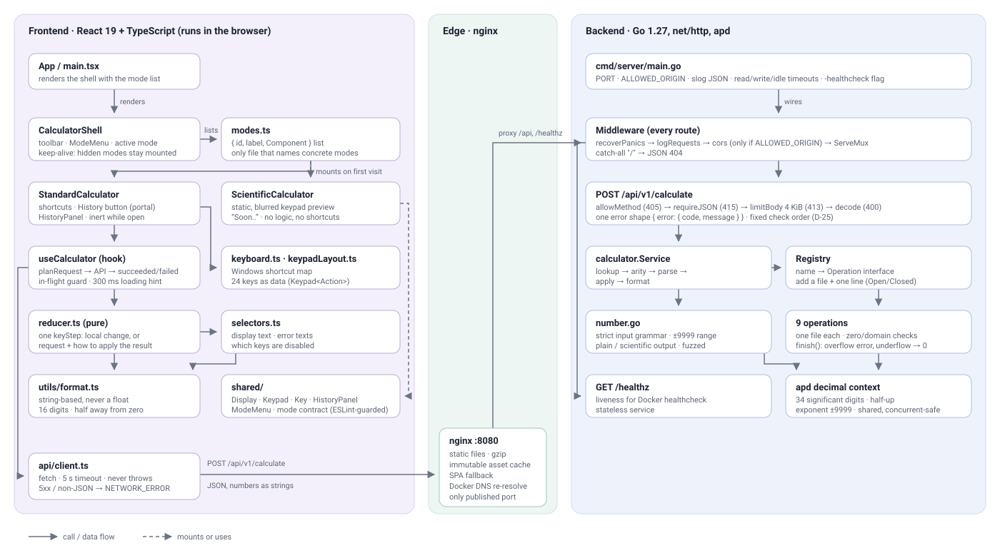

# Calculator

A full-stack calculator.

A Go backend and a React + TypeScript frontend only handles input and display.

<p align="center">
  
</p>

**Contents:**
[Features](#features) ·
[Quick start](#quick-start) ·
[Local development](#local-development) ·
[Testing](#testing--coverage) ·
[API](#api-reference) ·
[Architecture](#architecture) ·
[Design decisions](#design-decisions) ·
[Assumptions & limitations](#assumptions-deviations-from-windows-and-known-limitations) ·
[Future work](#trade-offs--future-work) ·
[AI usage](#ai-usage)

The full specification (requirements, design decisions, API contract, and plan) is in
[docs/SPEC.md](docs/SPEC.md).

## Features

- **Standard mode:** `+ − × ÷`, `%`, `√x`, `x²`, `1/x`, `+/-`, `CE`, `C`, `⌫`, and repeated `=`
  (`5 + 3 = = =` gives `8`, `11`, `14`).
- **Immediate execution, like Windows:** `2 + 3 × 4 =` gives `20`.
- **Exact decimals:** results keep 34 significant digits; the display shows 16 and switches to
  scientific notation for very large or small values.
- **History:** the icon at the top right opens past calculations; click one to reuse its result.
- **Mode menu:** the icon at the top left switches between Standard and a preview of Scientific
  mode (marked "Soon..").
- **Keyboard and accessibility:** every key has a shortcut and an accessible name, focus is always
  visible, and every label meets WCAG AA contrast.
- **Responsive:** works from 320 px wide, with the same behavior on every device.

| Key | Shortcut | Key | Shortcut |
|---|---|---|---|
| Digits, `.` | `0`–`9`, `.` | `=` | `Enter` or `=` |
| `+ − × ÷` | `+ - * /` | `⌫` | `Backspace` |
| `%` | `%` | `C` / `CE` | `Escape` / `Delete` |
| `√x` / `x²` / `1/x` | `@` / `q` / `r` | `+/-` | `F9` |

## Quick start

Requirements: Docker with Docker Compose v2.

```sh
docker compose up --build
```

Open <http://localhost:8080>. The API is served from the same address.

## Local development

Versions used during development:

| Tool | Version |
|---|---|
| Go | 1.27.3 |
| Node.js / npm | 24.18 / 11.16 |
| golangci-lint | 2.14 |

Run the backend and the frontend in two terminals:

```sh
# Terminal 1: API on http://localhost:8080
cd backend
go run ./cmd/server

# Terminal 2: UI on http://localhost:5173 (proxies /api and /healthz to the backend)
cd frontend
npm ci
npm run dev
```

Backend configuration:

| Variable | Default | Purpose |
|---|---|---|
| `PORT` | `8080` | Listen port |
| `ALLOWED_ORIGIN` | empty (CORS off) | Allowed origin when the frontend is served from a different origin |

## Testing & coverage

| | Command | Result |
|---|---|---|
| Backend tests | `cd backend && go test ./... -race -cover` | 161 tests and subtests, 98.2% of statements |
| Backend lint | `cd backend && gofmt -l . && golangci-lint run` | |
| Frontend tests | `cd frontend && npm run test:coverage` | 199 tests, 99.7% of lines |
| Frontend checks | `cd frontend && npm run lint && npm run format:check && npm run typecheck` | |

- **CI** (GitHub Actions) runs all of the above plus a Docker build on every push to `main`, and
  fails if coverage drops below 80% on either side.
- **Backend:** table-driven tests for every operation and error, `httptest` tests for every HTTP
  error code, and a fuzz test for number parsing:
  `cd backend && go test ./internal/calculator -run '^$' -fuzz FuzzParseNumber -fuzztime 30s`.
- **Frontend:** one reducer test per row of the key behavior tables in the spec, plus tests for
  formatting, the API client, the hook, each mode on its own, and the mode shell with fake modes.
- `-race` needs cgo and a C compiler. On Windows without gcc, run the tests without `-race`;
  CI runs them with it.

## API reference

The contract is in [docs/openapi.yaml](docs/openapi.yaml). Numbers are sent and returned as JSON
strings.

| Method | Path | Purpose |
|---|---|---|
| `POST` | `/api/v1/calculate` | Perform one operation |
| `GET` | `/healthz` | Health check: `{"status":"ok"}` |

Operations: `add`, `subtract`, `multiply`, `divide`, `percent_of` (two operands);
`percent`, `sqrt`, `square`, `reciprocal` (one operand).

```sh
curl -X POST http://localhost:8080/api/v1/calculate \
  -H 'Content-Type: application/json' \
  -d '{"operation": "add", "operands": ["0.1", "0.2"]}'
# 200 {"operation":"add","result":"0.3"}

curl -X POST http://localhost:8080/api/v1/calculate \
  -H 'Content-Type: application/json' \
  -d '{"operation": "divide", "operands": ["1", "0"]}'
# 422 {"error":{"code":"DIVISION_BY_ZERO","message":"Cannot divide by zero"}}
```

> **Windows:** in PowerShell, `curl` is an alias for `Invoke-WebRequest`. Use `curl.exe`, and put
> the JSON in a file (`-d "@body.json"`) to avoid quoting problems.

Every error has the same shape, `{ "error": { "code": "...", "message": "..." } }`:

| HTTP | Codes |
|---|---|
| 400 | `INVALID_JSON`, `VALIDATION_ERROR`, `INVALID_NUMBER`, `UNSUPPORTED_OPERATION`, `INVALID_OPERAND_COUNT` |
| 404 / 405 | `NOT_FOUND`, `METHOD_NOT_ALLOWED` |
| 413 / 415 | `PAYLOAD_TOO_LARGE` (body over 4 KiB), `UNSUPPORTED_MEDIA_TYPE` |
| 422 | `DIVISION_BY_ZERO`, `UNDEFINED_RESULT` (`0 ÷ 0`), `INVALID_DOMAIN` (√ of a negative), `OVERFLOW` |
| 500 | `INTERNAL_ERROR` |

When a request has several faults, the first failing check decides the response, in a fixed order
(SPEC D-25).

## Architecture

[](docs/architecture.svg)

*Click the diagram to open it at full size.*

**What happens when you press `=` after `5 + 3`:**

1. The pure **reducer** decides the key needs the backend and returns the request
   `add(5, 3)`; the **`useCalculator`** hook blocks further keys and sends it.
2. **`api/client.ts`** posts `{"operation":"add","operands":["5","3"]}` with a 5-second timeout.
3. **nginx** serves the frontend and forwards `/api` to the backend on the internal network.
4. The backend **middleware** recovers panics, logs, and applies CORS; the route checks the method,
   `Content-Type`, and the 4 KiB body limit, then decodes the JSON.
5. **`calculator.Service`** looks up `add` in the **registry**, checks the operand count, parses the
   operands, and computes with **apd** at 34 digits.
6. The result `"8"` goes back as a string; the reducer stores it at full precision and
   **`format.ts`** renders the display text without ever converting it to a float.

**Project structure:**

```
backend/
  cmd/server/              entry point: config, logging, timeouts, -healthcheck flag
  internal/api/            router, middleware, handlers, JSON errors
  internal/calculator/     service, registry, one file per operation, number format
frontend/src/
  api/                     typed backend client
  features/calculator/
    CalculatorShell.tsx    toolbar, mode menu, active mode
    modes.ts               the list of modes
    shared/                Display, Keypad, Key, HistoryPanel, ModeMenu, mode contract
    standard/              Standard mode: reducer, selectors, keyboard map, hook, UI
    scientific/            Scientific preview
  utils/format.ts          display formatting
docs/                      SPEC.md, openapi.yaml, architecture diagram, screenshot
```

- **Backend:** `net/http` only, no framework, in two layers (`api` → `calculator`). Adding an
  operation means adding one file and registering it.
- **Frontend:** a mode-independent shell shows one mode at a time; each mode owns its state,
  shortcuts, and panels. Adding a mode means one new folder and one entry in `modes.ts`. Shared
  code may not import a mode (enforced by ESLint).
- **Docker:** a distroless, non-root backend image and an nginx image that serves the frontend and
  proxies the API. Only nginx is published.

## Design decisions

All decisions with their rationale are in [SPEC §6](docs/SPEC.md#6-design-decisions). The most
important:

- **All arithmetic on the backend.** The frontend only edits notation: digits, the decimal point,
  and the sign. Rounding for display is the only exception, and it never changes the stored value.
- **Decimal arithmetic with 34 significant digits** (IEEE 754 decimal128), rounded half away from
  zero. Numbers travel as JSON strings, so no float ever touches a value.
- **One endpoint, one operation per request.** The operation name is in the body and maps directly
  onto the operation registry.
- **Full precision between steps.** The display shows 16 digits, but the next operation always
  receives the full 34-digit value.
- **Same origin.** The browser talks to one origin and a proxy forwards `/api`, so CORS is off
  unless `ALLOWED_ORIGIN` is set.
- **String-based display formatting.** `Intl.NumberFormat` turns values beyond the JavaScript
  number range into `∞`, while results go up to `1e9999`.
- **Keys are blocked during a request** instead of being queued: simple and deterministic.
- **Modes as plug-ins.** A small contract (`active`, `keyboardEnabled`, a toolbar slot) lets each
  calculator mode stay independent of the others.

## Assumptions, deviations from Windows, and known limitations

- **Reference:** Windows 11 Calculator, Standard mode. On mobile only the layout changes.
- **Deviation: `%` without a pending operator.** `10 %` gives `0.1`; Windows gives `0`.
- **Deviation: small-number notation.** Results from `1e-7` up to below `1e16` are shown in plain
  notation, everything else in scientific notation (`1.5e-8`). Windows uses a more complex rule.
- **Limitation: finite precision.** `1 ÷ 3 × 3` displays `1`, but `1 ÷ 3 × 3 − 1` gives `-1e-34`
  where Windows (exact rational arithmetic) gives `0`.
- **Limitation: range.** Results of `1e10000` or more (in magnitude) are an `OVERFLOW` error;
  results below `1e-9999` become `0`.
- **Limitation: history** is kept in memory per mode, so a reload clears it.

## Trade-offs & future work

- **Scientific mode** is only a preview. Building it needs operator precedence and parentheses, so
  it will get its own state machine and a `POST /api/v1/evaluate` endpoint that reuses the
  operation registry. The decimal library has no trigonometric functions, so those must be written
  at 34-digit precision.
- **Not built yet:** Programmer mode, memory keys, a light theme, and a live demo. A public
  deployment should add request rate limiting in nginx first.
- **Keys are blocked during a request** rather than queued; partial blocking is future work.

## Credits

The font is [Plus Jakarta Sans](https://github.com/tokotype/PlusJakartaSans), used under the
SIL Open Font License 1.1 ([frontend/src/assets/fonts/OFL.txt](frontend/src/assets/fonts/OFL.txt)).

## AI usage

This project was built with an AI assistant. [CLAUDE.md](CLAUDE.md) contains the instructions the
assistant worked under; [PROMPTS.md](PROMPTS.md) lists the prompts used.
