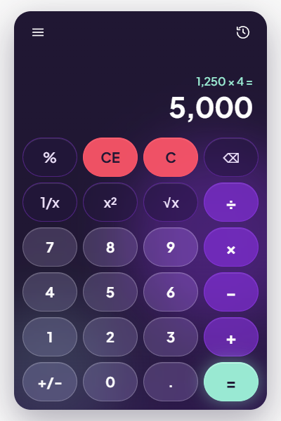

# Calculator

A full-stack calculator that behaves like the Windows 11 Calculator in Standard mode.
A Go backend performs every calculation with 34-digit decimal arithmetic; a React + TypeScript
frontend only handles input and display.

The full specification, including every requirement and design decision, is in
[docs/SPEC.md](docs/SPEC.md).

## Overview



- Standard mode: `+ − × ÷`, `%`, `√x`, `x²`, `1/x`, `+/-`, `CE`, `C`, `⌫`, and repeated `=`.
- Immediate execution like Windows: `2 + 3 × 4 =` gives `20`.
- Exact decimals: `0.1 + 0.2 = 0.3`. Results keep 34 significant digits internally; the display
  shows 16.
- Full keyboard support, including the Windows shortcuts (`@` √x, `q` x², `r` 1/x, `F9` ±).
- History of calculations: the icon at the top right opens it; click an entry to reuse its result.
- The display font shrinks for long numbers.
- A mode menu (top left) switches to a preview of Scientific mode, marked "Soon..".
- Works from 320 px wide; same behavior on every device.
- Dark purple design with frosted-glass keys; every label meets WCAG AA contrast.

## Quick start

Requirements: Docker with Docker Compose v2.

```sh
docker compose up --build
```

Open http://localhost:8080. The API is available at the same address.

## Local development

Prerequisites (versions used during development):

| Tool | Version |
|---|---|
| Go | 1.27.3 |
| Node.js / npm | 24.18 / 11.16 |
| golangci-lint | 2.14 |

Run the backend and the frontend in two terminals:

```sh
# Terminal 1: API on http://localhost:8080
cd backend
go run ./cmd/server

# Terminal 2: UI on http://localhost:5173 (proxies /api to the backend)
cd frontend
npm ci
npm run dev
```

Backend configuration (environment variables):

| Variable | Default | Purpose |
|---|---|---|
| `PORT` | `8080` | Listen port |
| `ALLOWED_ORIGIN` | empty (CORS off) | Allowed origin when the frontend runs on a different origin |

## Testing & coverage

| | Command | Coverage |
|---|---|---|
| Backend tests | `cd backend && go test ./... -race -cover` | 98.2% of statements |
| Backend lint | `cd backend && gofmt -l . && golangci-lint run` | |
| Frontend tests | `cd frontend && npm run test:coverage` | 99.6% of lines |
| Frontend checks | `cd frontend && npm run lint && npm run format:check && npm run typecheck` | |

- CI (GitHub Actions) runs all of the above on every push to `main`, plus a Docker build, and
  fails if coverage drops below 80% on either side.
- The backend has table-driven tests for every operation and error, `httptest` tests for every
  HTTP error code, and a fuzz test for number parsing:
  `cd backend && go test ./internal/calculator -run '^$' -fuzz FuzzParseNumber -fuzztime 30s`.
- The frontend has one reducer test per row of the key behavior tables in the spec, plus tests for
  formatting, the API client, the hook, and the components (mouse, keyboard, error states).
- `-race` needs cgo and a C compiler. On Windows without gcc, run the tests without `-race`;
  CI runs them with it.

## API reference

The contract is in [docs/openapi.yaml](docs/openapi.yaml). Numbers are JSON strings.

| Method | Path | Purpose |
|---|---|---|
| `POST` | `/api/v1/calculate` | Perform one operation |
| `GET` | `/healthz` | Health check |

Operations: `add`, `subtract`, `multiply`, `divide`, `percent_of` (two operands);
`percent`, `sqrt`, `square`, `reciprocal` (one operand).

```sh
curl -X POST http://localhost:8080/api/v1/calculate \
  -H 'Content-Type: application/json' \
  -d '{"operation": "add", "operands": ["0.1", "0.2"]}'
# 200 {"operation":"add","result":"0.3"}

curl -X POST http://localhost:8080/api/v1/calculate \
  -H 'Content-Type: application/json' \
  -d '{"operation": "divide", "operands": ["1", "0"]}'
# 422 {"error":{"code":"DIVISION_BY_ZERO","message":"Cannot divide by zero"}}
```

> **Windows:** in PowerShell, `curl` is an alias for `Invoke-WebRequest`. Use `curl.exe`, and
> put the JSON in a file (`-d "@body.json"`) to avoid quoting problems.

Every error has the same shape, `{ "error": { "code": "...", "message": "..." } }`:

| HTTP | Codes |
|---|---|
| 400 | `INVALID_JSON`, `VALIDATION_ERROR`, `INVALID_NUMBER`, `UNSUPPORTED_OPERATION`, `INVALID_OPERAND_COUNT` |
| 404 / 405 | `NOT_FOUND`, `METHOD_NOT_ALLOWED` |
| 413 / 415 | `PAYLOAD_TOO_LARGE` (body over 4 KiB), `UNSUPPORTED_MEDIA_TYPE` |
| 422 | `DIVISION_BY_ZERO`, `UNDEFINED_RESULT` (`0 ÷ 0`), `INVALID_DOMAIN` (√ of a negative), `OVERFLOW` |
| 500 | `INTERNAL_ERROR` |

## Architecture

```
Development:  Browser ──► Vite dev server :5173 ──/api──► Go backend :8080
Docker:       Browser ──► nginx :8080 ──/api, /healthz──► Go backend (internal network only)
```

- **Backend** (`backend/`): `net/http` only, no framework. Two layers:
  `internal/api` (handlers, middleware, JSON errors) → `internal/calculator` (service, registry,
  one file per operation, number parsing and formatting with `cockroachdb/apd`).
  Adding an operation means adding one file and registering it.
- **Frontend** (`frontend/src/features/calculator/`): a `CalculatorShell` holds the toolbar and
  the mode menu and shows one mode at a time. Each mode lives in its own folder (`standard/`,
  `scientific/`) with its own state and shortcuts; `shared/` holds the components every mode
  uses. Standard mode is a pure reducer plus a `useCalculator` hook that sends the requests.
  Adding a mode means one new folder and one entry in `modes.ts`.
- **Docker**: a distroless, non-root backend image and an nginx image that serves the frontend and
  proxies the API. Only nginx is published.

## Design decisions

The full list with rationale is in [SPEC §6](docs/SPEC.md#6-design-decisions). The most important:

- **All arithmetic on the backend.** The frontend only edits notation: digits, the decimal point,
  and the sign. Display rounding is the only exception, and it never changes the stored value.
- **Decimal arithmetic with 34 significant digits** (IEEE 754 decimal128), rounded half away
  from zero. Numbers travel as JSON strings, so no float ever touches a value.
- **One endpoint, one operation per request.** The operation name is in the body and maps
  directly onto the operation registry.
- **Full precision between steps.** The display shows 16 digits, but the next operation always
  receives the full 34-digit value.
- **Same origin.** The browser only talks to one origin; a proxy forwards `/api`, so CORS is off
  unless `ALLOWED_ORIGIN` is set.
- **String-based display formatting.** `Intl.NumberFormat` turns values beyond the JavaScript
  number range into `∞`, while results go up to `1e9999`.
- **Keys are blocked during a request** instead of being queued: simple and deterministic.

## Assumptions, deviations from Windows, and known limitations

- **Reference:** Windows 11 Calculator, Standard mode. On mobile only the layout changes.
- **Deviation: `%` without a pending operator.** `10 %` gives `0.1`; Windows gives `0`.
- **Deviation: small-number notation.** Results from `1e-7` up to below `1e16` are shown in plain
  notation, everything else in scientific notation (`1.5e-8`). Windows uses a more complex rule.
- **Limitation: finite precision.** `1 ÷ 3 × 3` displays `1`, but `1 ÷ 3 × 3 − 1` gives `-1e-34`
  where Windows (exact rational arithmetic) gives `0`.
- **Limitation: range.** Results of `1e10000` or more (in magnitude) are an `OVERFLOW` error;
  results below `1e-9999` become `0`.

## Trade-offs & future work

- Not built (deliberately): Scientific and Programmer modes and an expression parser with
  operator precedence. Scientific mode is only a blurred preview in the mode menu. The registry
  and the layout-as-data keypad are the extension points.
- Could-have features not built yet: memory keys, dark theme, a live demo. The history is kept
  in memory only, so it is lost on reload.
- Keys are blocked during a request rather than queued; partial blocking is future work.

## Credits

The font is [Plus Jakarta Sans](https://github.com/tokotype/PlusJakartaSans), used under the
SIL Open Font License 1.1 ([frontend/src/assets/fonts/OFL.txt](frontend/src/assets/fonts/OFL.txt)).

## AI usage

This project was built with an AI assistant. [CLAUDE.md](CLAUDE.md) contains the instructions the
assistant worked under; [PROMPTS.md](PROMPTS.md) lists the prompts used.
